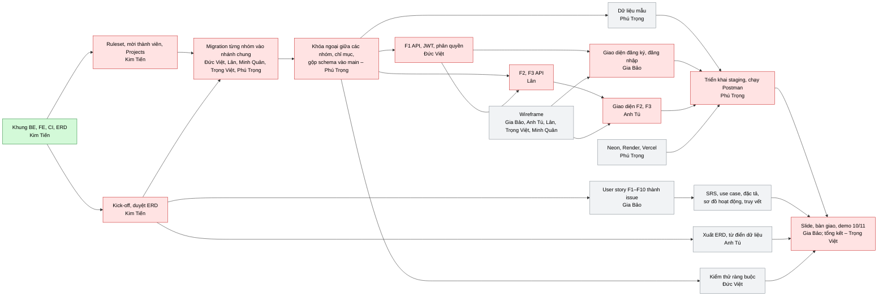
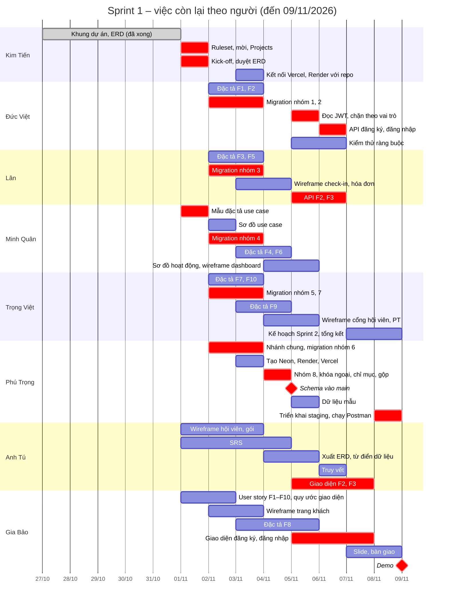

# Tiến độ và phân công Sprint 1

- **Ngày lập:** 01/11/2026
- **Đối chiếu:** commit `6657d5e` trên `main` với 49 đầu việc của kế hoạch Sprint 1 (mã WBS 1.1.1 … 1.9.2)
- **Sprint 1:** 27/10 – 09/11/2026, bàn giao và demo 10/11

Mục 1 liệt kê những gì commit đầu đã có. Mục 2 chia lại các việc còn lại cho 7 thành viên. Mục 3 là trạng thái từng đầu việc. Mục 4 sửa chỗ kế hoạch cũ lệch với quy tắc đã chốt. Mục 5 vẽ thứ tự và lịch làm đến 10/11. Mục 6 ghi những gì mỗi người cần biết hoặc cần nhận từ người khác trước khi làm.

## 1. Commit đầu tiên đã có gì (Hoàng Kim Tiến)

### Hạ tầng và quy trình

- Repo công khai trên GitHub. Nhánh `main` là nhánh duy nhất lâu dài; ruleset `protect-main` đã tạo nhưng **chưa bật**.
- Hook `.githooks/pre-push` chặn đẩy thẳng lên `main` từ máy cá nhân.
- [CONTRIBUTING.md](../../CONTRIBUTING.md): quy ước nhánh, commit, pull request, định nghĩa hoàn thành.
- `.github/`:
  - mẫu pull request;
  - 3 mẫu issue: user story, task, báo lỗi;
  - `CODEOWNERS`.
- `scripts/create-labels.sh` tạo nhãn F1–F20 và nhãn loại việc. **Chưa chạy** trên GitHub.
- CI GitHub Actions có hai job `Backend` (Maven verify, Testcontainers) và `Frontend` (lint, test, build). Mỗi job chỉ chạy khi thư mục của nó thay đổi. Lần chạy đầu: **xanh**.
- `docker-compose.yml` và `.env.example` cho PostgreSQL 16 trên máy cá nhân.
- Hướng dẫn cài đặt môi trường cho Windows và macOS, kèm các lỗi thường gặp: [cai-dat-moi-truong.md](../guides/cai-dat-moi-truong.md).

### Backend (Spring Boot 4.1, Java 21)

- Đóng gói theo chức năng: `feature/<chức năng>/...` ([ADR 0007](../decisions/0007-cau-truc-ma-nguon.md)).
- `common/`:
  - `BaseEntity` (id, `createdAt`, `updatedAt` kiểu UTC);
  - `PageResponse`;
  - ba ngoại lệ 404, 409, 422;
  - `GlobalExceptionHandler` trả `ProblemDetail` tiếng Việt, có trả 409 cho xung đột `@Version` và cho vi phạm ràng buộc.
- `config/`:
  - `SecurityConfig`: stateless, CORS, bcrypt; trả 401 và 403 bằng `ProblemDetail`; chỉ mở health và Swagger. **Chưa có** bộ lọc JWT.
  - `OpenApiConfig` (Swagger) và `JpaAuditingConfig`.
- Ba profile: `local` đọc `../.env`, `staging` đọc biến môi trường của Render và Neon, `ddl-auto: validate`.
- Flyway đã cấu hình và có quy ước đánh số migration ([db/migration/README.md](../../backend/src/main/resources/db/migration/README.md)). **Chưa có file migration nào.**
- `Dockerfile` để triển khai lên Render.
- Kiểm thử:
  - 6 ca đơn vị cho `GlobalExceptionHandler`;
  - 3 ca tích hợp: ngữ cảnh Spring khởi động, health, API chưa đăng nhập trả 401.

### Frontend (React, TypeScript, Vite, Ant Design 6)

- Bố cục theo vai trò: `PublicLayout` (khách), `AuthLayout`, `StaffLayout` (menu trái theo vai trò), `MemberLayout`, `UserMenu`.
- Định tuyến có `ProtectedRoute` chặn theo vai trò, kèm kiểm thử.
- `AuthProvider` và ô **giả lập vai trò** cho chế độ phát triển (sẽ thay bằng đăng nhập thật ở F1).
- Trang đăng nhập dạng tĩnh, chưa gọi API. Các trang 403, 404 và trang chủ theo vai trò.
- `services/http.ts` gọi `/api/v1` trên cùng domain: khi phát triển, Vite chuyển tiếp sang `localhost:8080`; khi triển khai, `vercel.json` chuyển tiếp sang Render ([ADR 0008](../decisions/0008-goi-api-cung-domain.md)).

### Tài liệu

- [Bản chốt phạm vi](../requirements/ban-chot-pham-vi.md) và [bối cảnh đề tài](../requirements/boi-canh-de-tai.md).
- ERD 39 bảng: [erd-v2.dbml](../design/erd/erd-v2.dbml) là bản chuẩn; [thiet-ke-du-lieu.md](../design/erd/thiet-ke-du-lieu.md) giải thích bảng, quan hệ, ràng buộc cần kiểm thử, kèm phần ánh xạ bảng ↔ chức năng.
- 8 ADR (0001–0008): công nghệ, 5 version, danh sách chờ, thanh toán tại quầy, ERD v2 (24 quyết định), quy trình Git, cấu trúc mã nguồn, gọi API cùng domain.
- [Quy tắc mã nguồn](../guides/quy-tac-ma-nguon.md): dùng làm hướng dẫn chung khi viết mã, kể cả khi dùng công cụ AI.
- Mẫu ADR, mẫu biên bản họp, bộ Postman có request health check.
- Kế hoạch Sprint 1 và product backlog F1–F20.

## 2. Phân công

### 2.1 Cách chia

- **Ai viết đặc tả và migration của chức năng nào thì làm luôn API hoặc giao diện của chức năng đó**, và sẽ tiếp tục làm chức năng đó ở Sprint 2. Như vậy không phải đọc lại tài liệu của người khác.
- **Ai vẽ wireframe màn hình nào thì làm giao diện màn hình đó.**
- Người gộp migration (giữ nhánh chung) làm luôn khóa ngoại giữa các nhóm bảng, chỉ mục, dữ liệu mẫu và triển khai staging, vì đều cần schema hoàn chỉnh.
- Việc nào Hoàng Kim Tiến đã làm xong hoặc làm dở trong commit đầu thì phần đã làm tính cho Kim Tiến, phần còn lại chia cho người khác.
- Hoàng Kim Tiến chỉ giữ những việc mà chỉ chủ repo hoặc trưởng nhóm làm được.
- Điểm theo story point của kế hoạch. Với việc đã làm dở, điểm được tách thành phần đã làm và phần còn lại; tổng vẫn là 136.

### 2.2 Tổng điểm mỗi người

| Thành viên | Phụ trách | Đã làm | Còn làm | Tổng |
| --- | --- | ---: | ---: | ---: |
| Hoàng Kim Tiến | Trưởng nhóm; khung dự án, ERD, quy trình | 24 | 3 | 27 |
| Bùi Trần Đức Việt | F1 backend: tài khoản, đăng nhập, phân quyền | 0 | 16 | 16 |
| Thái Hùng Lân | F2, F3 backend; đặc tả F3, F5 | 0 | 15 | 15 |
| Lê Phước Minh Quân | F4, F6; sơ đồ UML | 0 | 15 | 15 |
| Nguyễn Trọng Việt | F7, F9, F10; kế hoạch Sprint 2 | 0 | 16 | 16 |
| Nguyễn Phú Trọng | Gộp schema, dữ liệu mẫu, staging | 0 | 16 | 16 |
| Nguyễn Anh Tú | SRS, từ điển dữ liệu; giao diện F2, F3 | 0 | 15 | 15 |
| Phạm Gia Bảo | Frontend chung, F8; backlog, slide | 0 | 16 | 16 |
| **Tổng** | | **24** | **112** | **136** |

7 thành viên còn lại mỗi người 15–16 điểm. Hoàng Kim Tiến cao hơn vì đã làm trước phần khung dự án.

### 2.3 Việc của từng người

**Hoàng Kim Tiến – 3 điểm còn lại**

| WBS | Việc | Điểm | Hạn |
| --- | --- | ---: | --- |
| 1.1.1 | Chủ trì kick-off: chốt 4 câu hỏi mở, **cả nhóm duyệt ERD**, giao việc theo bảng này; hỏi giảng viên UML hay DFD | 2 | **02/11** (hỏi giảng viên trước 03/11) |
| 1.1.3 | Phần chỉ chủ repo làm được: bật ruleset, mời 7 thành viên, chạy script nhãn, tạo GitHub Projects và 4 mốc sprint; kết nối repo với Vercel và Render (xem mục 6.2) | 1 | 02/11 (Vercel, Render: 04/11) |
| – | Duyệt pull request theo cặp ở mục 2.4 | – | Liên tục |

Đã làm (24 điểm):

| WBS | Việc | Điểm đã làm |
| --- | --- | ---: |
| 1.1.2 | Kế hoạch và backlog F1–F20 | 3 |
| 1.3.1 | Thiết kế ERD 39 bảng | 3 |
| 1.5.1 | Repo, quy ước nhánh, mẫu PR | 2 |
| 1.5.3 | Khung Spring Boot | 3 |
| 1.5.4 | Khung React | 3 |
| 1.5.5 | CI | 3 |
| 1.2.2 | Ánh xạ bảng ↔ chức năng | 1 |
| 1.4.1 | Khung bố cục theo vai trò | 1 |
| 1.5.2 | Docker Compose | 1 |
| 1.5.6 | Quy tắc mã nguồn | 1 |
| 1.6.2 | Khung bảo mật | 1 |
| 1.6.3 | Giao diện đăng nhập tĩnh, menu | 1 |
| 1.9.2 | Dockerfile, profile staging, `vercel.json` | 1 |

**Bùi Trần Đức Việt – F1 backend (16)**

| WBS | Việc | Điểm | Hạn |
| --- | --- | ---: | --- |
| 1.2.5 | Đặc tả use case F1, F2 | 3 | 04/11 |
| 1.3.2 | Migration nhóm 1 Tài khoản và hệ thống, nhóm 2 Chi nhánh và cơ sở vật chất (`V1_xx`, `V2_xx`) | 3 | 04/11 |
| 1.6.2 | Phần còn lại của phân quyền: đọc JWT bằng `spring-boot-starter-oauth2-resource-server`, chặn API theo vai trò; tiện ích tạo token cho kiểm thử của người khác. **Làm trước 1.6.1** | 2 | 06/11 |
| 1.6.1 | API đăng ký, đăng nhập; JWT 15 phút, refresh token trong cookie | 5 | 07/11 |
| 1.3.10 | Kiểm thử ràng buộc cơ sở dữ liệu (Testcontainers, dùng chung hạ tầng kiểm thử với F1) | 3 | 07/11 |

Lý do gộp: bảng `users` và `refresh_tokens` do chính Đức Việt tạo, nên viết API F1 không phải chờ người khác giải thích.

**Thái Hùng Lân – F2, F3 backend (15)**

| WBS | Việc | Điểm | Hạn |
| --- | --- | ---: | --- |
| 1.2.6 | Đặc tả use case F3 Gói tập, F5 Thanh toán | 3 | 04/11 |
| 1.3.3 | Migration nhóm 3 Hội viên và gói tập (`V3_xx`) | 3 | 04/11 |
| 1.4.4 | Wireframe check-in tại quầy, hóa đơn và thanh toán VietQR | 3 | 05/11 |
| 1.7.1 | API hội viên: thêm, sửa, xem, tìm theo mã hoặc số điện thoại, phân trang; chưa có ảnh đại diện. Công bố bản nháp API **trước 05/11** cho Anh Tú | 3 | 07/11 |
| 1.8.1 | API danh mục gói: thêm, sửa, ngừng bán | 3 | 07/11 |

Lý do gộp: `members` và `packages` cùng nằm trong nhóm 3. Viết đặc tả F5 và vẽ wireframe hóa đơn cùng lúc giúp Lân làm F3 (đăng ký, gia hạn) và F5 ở Sprint 2 liền mạch.

**Lê Phước Minh Quân – F4, F6 và sơ đồ UML (15)**

| WBS | Việc | Điểm | Hạn |
| --- | --- | ---: | --- |
| 1.2.3 | Sơ đồ use case tổng quát và phân rã theo 6 tác nhân | 3 | 03/11 |
| 1.2.7 | Đặc tả use case F4 Check-in, F6 Dashboard | 3 | 05/11 |
| 1.2.11 | Sơ đồ hoạt động: check-in, danh sách chờ, đặt lịch PT | 3 | 06/11 |
| 1.3.4 | Migration nhóm 4 Check-in và lớp học (`V4_xx`) | 3 | 04/11 |
| 1.4.7 | Wireframe dashboard cơ bản | 2 | 06/11 |
| 1.5.6 | Phần còn lại: mẫu đặc tả use case để 5 người viết đặc tả dùng chung (không dùng Spec Kit). **Làm đầu tiên**, vì đặc tả bắt đầu từ 02/11 | 1 | 02/11 |

Lý do gộp: cùng một người dùng công cụ vẽ UML cho cả use case và sơ đồ hoạt động. Đặc tả F4 và sơ đồ hoạt động check-in là cùng một luồng. Bảng `checkins` là dữ liệu của cả F4 và F6.

**Nguyễn Trọng Việt – F7, F9, F10 và kế hoạch Sprint 2 (16)**

| WBS | Việc | Điểm | Hạn |
| --- | --- | ---: | --- |
| 1.2.8 | Đặc tả use case F7 Cổng hội viên, F10 Thông báo | 2 | 04/11 |
| 1.2.10 | Đặc tả use case F9 Huấn luyện viên | 3 | 05/11 |
| 1.3.5 | Migration nhóm 5 Huấn luyện viên, nhóm 7 Nhân sự (`V5_xx`, `V7_xx`) | 3 | 04/11 |
| 1.4.5 | Wireframe cổng hội viên | 3 | 06/11 |
| 1.4.6 | Wireframe huấn luyện viên | 3 | 06/11 |
| 1.1.5 | Điều phối họp tổng kết; soạn kế hoạch chi tiết Sprint 2 | 2 | 09/11 |

Lý do gộp: Sprint 2 làm F7–F10, phần lớn do Trọng Việt đặc tả, nên Trọng Việt lập kế hoạch Sprint 2 là hợp lý nhất. `pt_sessions` (nhóm 5) trỏ tới `staff` (nhóm 7), nên một người làm cả hai nhóm.

**Nguyễn Phú Trọng – gộp schema, dữ liệu mẫu, staging (16)**

| WBS | Việc | Điểm | Hạn |
| --- | --- | ---: | --- |
| 1.3.6 | Migration nhóm 6 Bán hàng và thanh toán (`V6_xx`) | 3 | 04/11 |
| 1.3.7 | Migration nhóm 8 Gamification và **khóa ngoại giữa các nhóm bảng** (cuối dải `V8_xx`) | 2 | 05/11 |
| 1.3.8 | Rà ràng buộc và chỉ mục trên cả 39 bảng; giữ nhánh chung `chore/db-schema-ban-dau`, mở pull request gộp vào `main` | 3 | 05/11 |
| 1.3.9 | Dữ liệu mẫu cho demo theo [db/seed/README.md](../../backend/src/main/resources/db/seed/README.md) | 3 | 06/11 |
| 1.5.2 | Phần còn lại: tạo cơ sở dữ liệu Neon | 1 | 04/11 |
| 1.9.2 | Phần còn lại: tạo Render, Vercel, thay địa chỉ trong `vercel.json`, triển khai | 2 | 09/11 |
| 1.9.1 | Chạy bộ Postman F1–F3 trên staging trước demo | 2 | 09/11 |

Lý do gộp: người giữ nhánh chung nhìn thấy cả 39 bảng nên làm khóa ngoại giữa các nhóm bảng và chỉ mục dễ nhất. Dữ liệu mẫu và staging đều cần schema hoàn chỉnh. Tạo Neon sớm (04/11) để staging không dồn vào ngày cuối.

**Nguyễn Anh Tú – tài liệu và giao diện F2, F3 (15)**

| WBS | Việc | Điểm | Hạn |
| --- | --- | ---: | --- |
| 1.2.1 | SRS: tổng quan, 6 vai trò, NF1–NF6, S1–S10 | 3 | 05/11 |
| 1.2.2 | Phần còn lại của bảng truy vết: thêm cột use case | 2 | 07/11 |
| 1.3.11 | Xuất ERD từ DBML và từ điển dữ liệu cho báo cáo LaTeX | 2 | 06/11 |
| 1.4.3 | Wireframe hồ sơ hội viên, danh mục gói, bán và gia hạn gói | 3 | 04/11 |
| 1.7.2 | Giao diện danh sách, tìm kiếm, form hồ sơ hội viên | 3 | 08/11 |
| 1.8.2 | Giao diện danh mục gói | 2 | 08/11 |

Lý do gộp: SRS, bảng truy vết và từ điển dữ liệu đều đưa vào báo cáo LaTeX. Wireframe hội viên và gói do chính Anh Tú vẽ nên Anh Tú làm luôn giao diện.

**Phạm Gia Bảo – frontend chung, F8, backlog, slide (16)**

| WBS | Việc | Điểm | Hạn |
| --- | --- | ---: | --- |
| 1.2.4 | User story và tiêu chí chấp nhận F1–F10; tạo thành issue trên GitHub Projects | 3 | 03/11 |
| 1.4.1 | Phần còn lại: viết quy ước giao diện, wireframe trang đăng ký | 1 | 03/11 |
| 1.4.2 | Wireframe trang khách: bảng giá, lịch lớp công khai | 2 | 04/11 |
| 1.2.9 | Đặc tả use case F8 Lớp học nhóm | 5 | 06/11 |
| 1.6.3 | Phần còn lại: trang đăng ký, nối đăng nhập với API thật | 2 | 08/11 |
| 1.1.4 | Slide Beamer và gói bàn giao 10/11 | 3 | 09/11 |

Lý do gộp: Gia Bảo dựng khung frontend nên giữ phần giao diện dùng chung. Lịch lớp công khai trên trang khách là dữ liệu của F8. Slide demo dùng chính các màn hình Gia Bảo làm.

### 2.4 Cặp duyệt pull request

Mỗi pull request cần 1 người duyệt. Ghép cặp cố định để không nghẽn khâu duyệt trong 05/11–08/11:

| Người mở pull request | Người duyệt chính | Lý do |
| --- | --- | --- |
| Đức Việt ↔ Lân | Lẫn nhau | Cùng làm backend F1–F3 |
| Anh Tú ↔ Gia Bảo | Lẫn nhau | Cùng làm frontend |
| Minh Quân ↔ Trọng Việt | Lẫn nhau | Cùng làm đặc tả, wireframe |
| Phú Trọng | Hoàng Kim Tiến | Schema và triển khai ảnh hưởng cả nhóm |

Pull request migration vào nhánh chung do Phú Trọng duyệt. Pull request gộp schema vào `main` do Hoàng Kim Tiến duyệt.

## 3. Trạng thái từng đầu việc

Ký hiệu: ✅ xong · 🟡 xong một phần · ⬜ chưa làm.

| WBS | Việc | Trạng thái | Người |
| --- | --- | --- | --- |
| 1.1.1 | Họp kick-off | ✅ 02/11 ([biên bản](../meetings/2026-11-02-kick-off.md)) | Kim Tiến |
| 1.1.2 | Kế hoạch, backlog | ✅ | Kim Tiến |
| 1.1.3 | GitHub Projects | 🟡 | Kim Tiến |
| 1.1.4 | Slide, bàn giao | ⬜ | Gia Bảo |
| 1.1.5 | Tổng kết, kế hoạch Sprint 2 | ⬜ | Trọng Việt |
| 1.2.1 | SRS | ⬜ | Anh Tú |
| 1.2.2 | Bảng truy vết | 🟡 | Kim Tiến (bảng ↔ chức năng), Anh Tú (phần còn lại) |
| 1.2.3 | Sơ đồ use case | ⬜ | Minh Quân |
| 1.2.4 | User story F1–F10 | ⬜ | Gia Bảo |
| 1.2.5 | Đặc tả F1, F2 | ⬜ | Đức Việt |
| 1.2.6 | Đặc tả F3, F5 | ⬜ | Lân |
| 1.2.7 | Đặc tả F4, F6 | ⬜ | Minh Quân |
| 1.2.8 | Đặc tả F7, F10 | ⬜ | Trọng Việt |
| 1.2.9 | Đặc tả F8 | ⬜ | Gia Bảo |
| 1.2.10 | Đặc tả F9 | ⬜ | Trọng Việt |
| 1.2.11 | Sơ đồ hoạt động | ⬜ | Minh Quân |
| 1.3.1 | Chốt ERD | ✅ cả nhóm duyệt 02/11 | Kim Tiến |
| 1.3.2 | Migration nhóm 1, 2 | ⬜ | Đức Việt |
| 1.3.3 | Migration nhóm 3 | ⬜ | Lân |
| 1.3.4 | Migration nhóm 4 | ⬜ | Minh Quân |
| 1.3.5 | Migration nhóm 5, 7 | ⬜ | Trọng Việt |
| 1.3.6 | Migration nhóm 6 | ⬜ | Phú Trọng |
| 1.3.7 | Migration nhóm 8, khóa ngoại giữa các nhóm | ⬜ | Phú Trọng |
| 1.3.8 | Ràng buộc, chỉ mục, gộp schema | ⬜ | Phú Trọng |
| 1.3.9 | Dữ liệu mẫu | ⬜ | Phú Trọng |
| 1.3.10 | Kiểm thử ràng buộc | ⬜ | Đức Việt |
| 1.3.11 | Xuất ERD, từ điển dữ liệu | ⬜ | Anh Tú |
| 1.4.1 | Quy ước giao diện, khung bố cục | 🟡 | Kim Tiến (khung), Gia Bảo (phần còn lại) |
| 1.4.2 | Wireframe trang khách | ⬜ | Gia Bảo |
| 1.4.3 | Wireframe hội viên, gói | ⬜ | Anh Tú |
| 1.4.4 | Wireframe check-in, hóa đơn | ⬜ | Lân |
| 1.4.5 | Wireframe cổng hội viên | ⬜ | Trọng Việt |
| 1.4.6 | Wireframe huấn luyện viên | ⬜ | Trọng Việt |
| 1.4.7 | Wireframe dashboard | ⬜ | Minh Quân |
| 1.5.1 | Repo, quy ước nhánh, mẫu PR | ✅ | Kim Tiến |
| 1.5.2 | PostgreSQL chung | 🟡 | Kim Tiến (Docker Compose), Phú Trọng (Neon) |
| 1.5.3 | Khung Spring Boot | ✅ | Kim Tiến |
| 1.5.4 | Khung React | ✅ | Kim Tiến |
| 1.5.5 | CI | ✅ | Kim Tiến |
| 1.5.6 | Quy ước đặc tả, hướng dẫn công cụ AI | 🟡 | Kim Tiến (quy tắc mã nguồn), Minh Quân (mẫu đặc tả use case) |
| 1.6.1 | API đăng ký, đăng nhập | ⬜ | Đức Việt |
| 1.6.2 | Phân quyền | 🟡 | Kim Tiến (khung), Đức Việt (JWT, chặn theo vai trò) |
| 1.6.3 | Giao diện đăng nhập, đăng ký, menu | 🟡 | Kim Tiến (tĩnh), Gia Bảo (đăng ký, nối API) |
| 1.7.1 | API hội viên | ⬜ | Lân |
| 1.7.2 | Giao diện hội viên | ⬜ | Anh Tú |
| 1.8.1 | API danh mục gói | ⬜ | Lân |
| 1.8.2 | Giao diện danh mục gói | ⬜ | Anh Tú |
| 1.9.1 | Postman F1–F3 trên staging | ⬜ | Phú Trọng |
| 1.9.2 | Triển khai staging | 🟡 | Kim Tiến (chuẩn bị), Phú Trọng (triển khai) |

## 4. Chỉnh lại so với kế hoạch cũ

1. **Mỗi người tự viết kiểm thử JUnit cho mã của mình** (quy tắc số 14). Vì vậy việc 1.9.1 chỉ còn là chạy lại bộ Postman trên staging trước demo.
2. **Migration không còn là 6 pull request riêng vào `main`.** Quy tắc yêu cầu đủ 39 bảng trong một pull request.
   - Mỗi người mở pull request vào nhánh chung `chore/db-schema-ban-dau` do Phú Trọng giữ.
   - Phú Trọng mở **một** pull request từ nhánh chung vào `main`.
   - Các bước chi tiết: [db/migration/README.md](../../backend/src/main/resources/db/migration/README.md#làm-schema-ban-đầu-qua-nhánh-chung).
3. **Dữ liệu mẫu:**
   - Có 5 vai trò có tài khoản (kế hoạch cũ ghi 6); khách không đăng nhập.
   - Đặt ở thư mục riêng `db/seed`, chỉ profile `local` và `staging` đọc. Đã cấu hình xong.
   - Mật khẩu là mã băm lấy từ biến môi trường.
   - Chi tiết: [db/seed/README.md](../../backend/src/main/resources/db/seed/README.md).
   - Chi nhánh mặc định và giá trị mặc định của `system_configs` là dữ liệu cần ở mọi môi trường, nên viết thành migration bình thường.
4. **Trạng thái dùng `varchar` + `CHECK`**, không dùng kiểu enum của PostgreSQL (quy tắc số 10). Kế hoạch cũ ghi "toàn bộ kiểu enum" ở 1.3.7.
5. **Bản chuẩn của ERD là `erd-v2.dbml`** (cập nhật 01/11), không phải tài liệu ERD ngày 27/10.
6. **Không dùng GitHub Spec Kit.** Đặc tả viết theo mẫu issue user story và mẫu đặc tả use case (việc 1.5.6), lưu ở `docs/requirements/srs/`.

## 5. Thứ tự và lịch làm

### 5.1 Thứ tự phụ thuộc

Đường tô đỏ là đường găng: trễ một ngày ở đây thì demo 10/11 trễ theo.

F2 và F3 cần F1 để gọi API khi đã đăng nhập. Trong lúc chờ, Lân viết service và kiểm thử Mockito trước, rồi nối bảo mật khi F1 xong. Tương tự, Anh Tú và Gia Bảo làm giao diện với dữ liệu giả trước khi có API thật.

### 5.2 Lịch theo người

### 5.3 Rủi ro chính

- **Migration là nút cổ chai.** API chỉ chạy với bảng thật sau khi schema gộp vào `main` (dự kiến 05/11). Muốn giữ được ngày này thì ERD phải được duyệt ở kick-off **trước 02/11**.
- **Bàn giao 10/11 cần cả demo F1–F3 trên staging.** Nếu đến 07/11 F2 hoặc F3 chưa xong, chỉ demo F1 cộng schema và tài liệu, phần còn lại chuyển sang Sprint 2.
- **Gia Bảo và Phú Trọng dồn việc vào 08/11–09/11** (giao diện, slide, triển khai). Nếu trễ, Hoàng Kim Tiến hỗ trợ slide; Trọng Việt hỗ trợ chạy Postman.

## 6. Rà soát từ góc nhìn người làm

Mỗi việc được đọc lại như thể chính người nhận việc chuẩn bị bắt tay vào làm, để tìm chỗ thiếu thông tin hoặc vướng. Quyết định đã chốt ngày 01/11 được ghi vào tài liệu nguồn; mục này chỉ tóm tắt.

### 6.1 Đã chốt thêm ngày 01/11

| Câu hỏi | Quyết định | Ghi ở |
| --- | --- | --- |
| Thư viện JWT (Đức Việt) | `spring-boot-starter-oauth2-resource-server`, ký HS256 bằng `JWT_SECRET` | [ADR 0001](../decisions/0001-cong-nghe.md) |
| Định dạng mã hội viên (Lân) | `HV` + 6 chữ số (`HV000123`), sinh từ sequence `member_code_seq` dùng chung cả chuỗi | [erd-v2.dbml](../design/erd/erd-v2.dbml), [thiet-ke-du-lieu.md](../design/erd/thiet-ke-du-lieu.md) |
| Ảnh đại diện (Lân, Anh Tú) | Sprint 1 làm F2 chưa có ảnh; chốt nơi lưu trước khi làm F4 ở Sprint 2 (ổ đĩa Render miễn phí không giữ file) | [thiet-ke-du-lieu.md](../design/erd/thiet-ke-du-lieu.md) |
| Công cụ vẽ (6 người vẽ wireframe, Minh Quân) | draw.io, lưu `.drawio.svg` trong `docs/design/` | [docs/README.md](../README.md) |
| Dữ liệu mẫu (Phú Trọng) | Thư mục `db/seed` riêng, migration lặp lại `R__`, mật khẩu là mã băm từ biến môi trường | [db/seed/README.md](../../backend/src/main/resources/db/seed/README.md) |
| Spec Kit (Minh Quân) | Không dùng | Mục 4 |

### 6.2 Phụ thuộc giữa người với người

Những chỗ một người phải giao trước cho người khác. Bỏ sót là kẹt ở 05/11–07/11.

| Người giao | Người nhận | Giao gì | Hạn |
| --- | --- | --- | --- |
| Hoàng Kim Tiến | Cả nhóm | Lời mời vào repo, nhãn, GitHub Projects; ERD đã duyệt | 02/11 |
| Minh Quân | 5 người viết đặc tả | Mẫu đặc tả use case | 02/11 |
| Phú Trọng | 5 người viết migration | Nhánh chung `chore/db-schema-ban-dau` | 02/11 |
| Lân | Anh Tú | Bản nháp API F2, F3 (đường dẫn, DTO) trong đặc tả hoặc trên Swagger, để giao diện làm song song | 05/11 |
| Đức Việt | Lân, Anh Tú, Gia Bảo | Bộ lọc JWT chặn theo vai trò và tiện ích tạo token cho kiểm thử, để F2, F3 gọi được API khi đã đăng nhập | 06/11 |
| Lân | Đức Việt | `MemberService` tạo hồ sơ hội viên (sinh `member_code`, chuẩn hóa số điện thoại, từ chối số đã có hồ sơ). Đăng ký F1 gọi service này, không tự ghi bảng `members` (chức năng chỉ gọi nhau qua service) | 06/11 |
| Hoàng Kim Tiến | Phú Trọng | Kết nối repo với Vercel và Render. Chỉ chủ repo cài được ứng dụng GitHub của hai nền tảng này; Phú Trọng chuẩn bị Neon và biến môi trường, rồi hai người cùng triển khai | 04/11 |
| Phú Trọng | Cả nhóm | Schema 39 bảng trên `main` | 05/11 |

### 6.3 Lưu ý riêng cho từng người

**Đức Việt**

- Theo bản chốt phạm vi, tự đăng ký tạo cả `users` (vai trò `MEMBER`) và `members` thuộc chi nhánh mặc định. Số điện thoại đã có hồ sơ thì từ chối (409) và hướng dẫn liên hệ quầy.
- Refresh token: lưu mã băm SHA-256 trong `refresh_tokens.token_hash`. Mỗi lần làm mới thì thu hồi token cũ và cấp token mới. Cookie theo [ADR 0008](../decisions/0008-goi-api-cung-domain.md): `HttpOnly; Secure; SameSite=Strict; Path=/api/v1/auth`.
- Khóa đăng nhập sau 5 lần sai (S4) và quên mật khẩu để Sprint 2. Cột `failed_login_count` và `locked_until` đã có sẵn trong bảng.
- Kiểm thử ràng buộc (1.3.10) theo bảng "Quan hệ và ràng buộc quan trọng" trong [thiet-ke-du-lieu.md](../design/erd/thiet-ke-du-lieu.md).

**Lân**

- Số điện thoại: chuẩn hóa về 10 chữ số bắt đầu bằng 0 trước khi lưu và trước khi tìm, ví dụ `+84 912 345 678` thành `0912345678`. Viết một hàm dùng chung trong `common/` vì F1 cũng cần.
- Tạo `member_code_seq` trong migration nhóm 3, kèm `CHECK` định dạng mã.
- Quyền: lễ tân tạo và sửa hội viên; quản lý chi nhánh quản lý gói tập ([bảng vai trò](../requirements/ban-chot-pham-vi.md)). Cần ghi rõ trong đặc tả:
  - chủ chuỗi có xem và sửa được không;
  - gói toàn chuỗi (`packages.branch_id` rỗng) để đến v4.
- Tìm kiếm dưới 2 giây (NF1):
  - tìm đúng mã hoặc đúng số điện thoại thì dùng chỉ mục duy nhất có sẵn;
  - tìm theo tên thì dùng chỉ mục `full_name`, chỉ tìm theo phần đầu tên.

**Minh Quân**

- Bộ sơ đồ đã chốt theo [ADR 0009](../decisions/0009-bo-so-do-phan-tich-thiet-ke.md): UML, không dùng DFD. Sprint 1 chỉ làm sơ đồ use case và sơ đồ hoạt động.
- Mẫu đặc tả use case đặt ở `docs/requirements/srs/mau-dac-ta-use-case.md`, gồm:
  - tác nhân và tiền điều kiện;
  - luồng chính;
  - luồng thay thế và ngoại lệ;
  - quy tắc nghiệp vụ, trỏ về bản chốt phạm vi;
  - bảng dữ liệu liên quan.

**Trọng Việt**

- Sprint 2 là 10/11 – 23/11. Kế hoạch Sprint 2 gồm phần còn lại của v1 (đăng ký và gia hạn gói F3, F4, F5, F6, quên mật khẩu, khóa đăng nhập) và F7–F10.
- Đưa câu hỏi "lưu ảnh đại diện ở đâu" vào đầu Sprint 2, vì F4 cần ảnh.

**Phú Trọng**

- `JWT_SECRET` và mật khẩu Neon chỉ nhập thẳng vào Render, không gửi qua chat nhóm, không ghi vào repo (S6).
- Render bản miễn phí ngủ sau 15 phút không dùng, lần gọi đầu mất khoảng 1 phút. Trước giờ demo phải mở trang trước vài phút.
- CI chạy cho mọi pull request, kể cả pull request vào nhánh chung, nên migration của từng nhóm được kiểm tra ngay khi mở.

**Anh Tú**

- SRS viết Markdown trong `docs/requirements/srs/` để duyệt qua pull request; khi làm báo cáo mới chuyển sang LaTeX.
- Từ điển dữ liệu xuất từ `erd-v2.dbml`: mỗi bảng gồm cột, kiểu, ràng buộc và ý nghĩa, lấy từ phần ghi chú có sẵn trong DBML.
- Giao diện F2 làm trước với dữ liệu giả theo bản nháp API của Lân, nối API thật khi có.

**Gia Bảo**

- Trưởng nhóm tạo nhãn và GitHub Projects ngày 02/11; phải có hai thứ này thì mới tạo user story thành issue được.
- Slide cần mẫu Beamer HUST. Mẫu chưa có trong repo; xin trưởng nhóm file mẫu.
- Lịch lớp công khai trên trang khách lấy dữ liệu F8. Ở Sprint 1 chỉ vẽ wireframe, chưa làm giao diện.

**Cả nhóm (ngày đầu tiên)**

- Nhận lời mời vào repo, clone, chạy `git config core.hooksPath .githooks`.
- Cài môi trường theo [cai-dat-moi-truong.md](../guides/cai-dat-moi-truong.md). Người viết backend cần Docker chạy được, vì kiểm thử dùng Testcontainers.
- Ai vẽ sơ đồ thì cài tiện ích draw.io cho VS Code.
