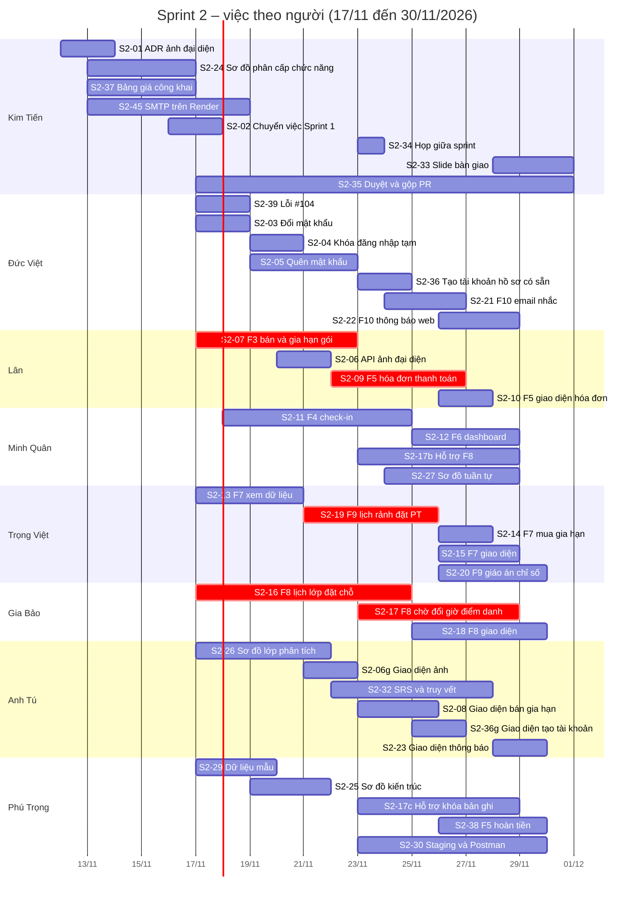

# Kế hoạch Sprint 2 (17/11 – 30/11/2026)

- **Trạng thái:** đã chốt phân công (trưởng nhóm, 12/11/2026); thống nhất lại tại [họp tổng kết Sprint 1](../meetings/2026-11-10-tong-ket-sprint-1.md) sau demo 17/11
- **Người lập:** Nguyễn Trọng Việt; Hoàng Kim Tiến chỉnh phân công và lịch ngày 12/11
- **Nguồn:** [bản chốt phạm vi](../requirements/ban-chot-pham-vi.md), [tiến độ Sprint 1](sprint-1-tien-do.md), [ADR 0009](../decisions/0009-bo-so-do-phan-tich-thiet-ke.md), [ADR 0010](../decisions/0010-danh-sach-cho-tu-dong-dua-vao-lop-ban-2.md), user story F1–F10 và milestone Sprint 2 trên GitHub

**Về ngày:** Sprint 1 kết thúc 16/11 và demo thứ Ba 17/11 (buổi học CNPM). Sprint 2 chạy 14 ngày, từ 17/11 đến 30/11; demo Sprint 2 dự kiến thứ Ba 01/12.

**Nguyên tắc chia việc:**
1. Mỗi người giữ một cụm chức năng, làm trọn từ API đến giao diện và kiểm thử.
2. Ai đã viết đặc tả, migration, wireframe hoặc mã của phần nào ở Sprint 1 thì tiếp tục phần đó. Hạn chế tối đa việc giao người chưa từng tiếp xúc làm phần của người khác.
3. Việc nhỏ, việc quản trị và slide do trưởng nhóm làm.

## 1. Phạm vi

- **Phần còn lại của v1:** F1 (đổi mật khẩu, quên và đặt lại mật khẩu, khóa đăng nhập tạm, lỗi #104), F2 (tạo tài khoản cho hồ sơ có sẵn, ảnh đại diện, chỉ số cơ thể), F3 (bán và gia hạn gói, xem bảng giá công khai), F4 (check-in tại quầy), F5 (thanh toán tại quầy, hoàn tiền có kiểm soát), F6 (dashboard cơ bản).
- **v2:** F7 (cổng hội viên), F8 (lớp học nhóm), F9 (huấn luyện viên), F10 (thông báo).
- **Chuyển từ Sprint 1:** việc nào chưa xong khi Sprint 1 đóng ngày 16/11 được chuyển thành issue Sprint 2 ở việc S2-02, giữ người phụ trách cũ.
- **Ngoài phạm vi Sprint 2:** v3 trở đi (F11–F20); sơ đồ lớp thiết kế (chuyển Sprint 3, xem mục 2.9).

## 2. Việc cần làm

**Cụm chức năng của từng người:**

| Người | Cụm Sprint 2 | Đã tiếp xúc ở Sprint 1 |
| --- | --- | --- |
| Bùi Trần Đức Việt | Tài khoản và thông báo: F1 còn lại, F2.2 (API), F10 (API) | Đặc tả F1, F2; migration nhóm 1 (gồm `notifications`, `system_configs`); API F1; adapter tài khoản F1–F2 |
| Thái Hùng Lân | Bán gói và thu tiền: F3.2, F5.1; F2.3 ảnh đại diện (API) | Đặc tả F3, F5; migration nhóm 3; API F2, F3; wireframe hóa đơn, VietQR |
| Lê Phước Minh Quân | Check-in và dashboard: F4, F6; hỗ trợ F8 phần lớp học, danh sách chờ | Đặc tả F4, F6; migration nhóm 4 (`checkins`, bảng lớp học); sơ đồ hoạt động check-in, danh sách chờ |
| Nguyễn Trọng Việt | Cổng hội viên và huấn luyện viên: F7, F9; chỉ số cơ thể | Đặc tả F7, F9; migration nhóm 5, 7; wireframe cổng hội viên, huấn luyện viên |
| Phạm Gia Bảo | Lớp học nhóm: F8 trọn gói | Đặc tả F8; wireframe lịch lớp công khai |
| Nguyễn Anh Tú | Giao diện quầy (F2.2, F2.3, F3.2, F10) và tài liệu (SRS, truy vết, sơ đồ lớp phân tích) | Wireframe và giao diện hội viên, gói; SRS, truy vết |
| Nguyễn Phú Trọng | Hoàn tiền F5.2; dữ liệu mẫu; staging và Postman; sơ đồ kiến trúc; hỗ trợ khóa bản ghi | Migration nhóm 6 (`invoices`, `payments`), khóa ngoại, chỉ mục toàn schema; dữ liệu mẫu; staging |
| Hoàng Kim Tiến | Điều phối, việc nhỏ, bảng giá công khai (F3.3), slide, duyệt và gộp PR | — |

### 2.1 Trưởng nhóm (phần lớn xong trước 17/11)

| Mã | Việc | Bắt đầu | Hạn | Ghi chú | Issue |
| --- | --- | --- | --- | --- | --- |
| S2-01 | Viết ADR 0011: ảnh đại diện lưu trong PostgreSQL (thu nhỏ, nén, bảng riêng, API có kiểm tra quyền) | 12/11 | 13/11 | Đã chốt phương án 12/11 | — |
| S2-40 | Mở issue ghim "Giữ số migration `V9_xx`" | 13/11 | 13/11 | Phú Trọng theo dõi trong sprint | — |
| S2-42 | Sửa milestone Sprint 2 (hạn 30/11) | 13/11 | 13/11 | — | — |
| S2-44 | Xuất lại hình ERD, ghi TV-01, TV-04 trong bảng truy vết đã xử lý | 13/11 | 13/11 | Phần còn lại của #109 | — |
| S2-24 | Sơ đồ phân cấp chức năng | 13/11 | 16/11 | — | — |
| S2-37 | F3: bảng giá công khai cho khách, API và giao diện | 13/11 | 16/11 | Lân duyệt API, Gia Bảo duyệt giao diện | US-F3.3 (#57) |
| S2-43 | Ngừng bán các gói thử Postman trên staging | 13/11 | 16/11 | Trước demo Sprint 1 | — |
| S2-41 | Tạo issue task cho mọi việc S2-xx | 13/11 | 16/11 | Sau khi kế hoạch này gộp | — |
| S2-02 | Chuyển việc Sprint 1 còn dở thành issue Sprint 2 | 16/11 | 17/11 | Giữ người phụ trách cũ | — |
| S2-45 | Chọn dịch vụ SMTP, nhập khóa lên Render, thêm biến vào `.env.example` | 13/11 | 18/11 | S2-05, F10 cần; khóa chỉ nhập trên Render (S6) | — |
| S2-34 | Họp giữa sprint: rà tiến độ, kiểm tra staging, quyết định lùi việc theo mục 5 | 23/11 | 23/11 | — | — |
| S2-33 | Slide và gói bàn giao Sprint 2 | 28/11 | 30/11 | Dùng theme Sprint 1 | — |
| S2-35 | Duyệt và gộp pull request, rải đều trong sprint | 17/11 | 30/11 | — | — |

### 2.2 Bùi Trần Đức Việt – tài khoản và thông báo

| Mã | Việc | Bắt đầu | Hạn | Phụ thuộc, ghi chú | Issue |
| --- | --- | --- | --- | --- | --- |
| S2-39 | F1: sửa lỗi refresh token dùng được 2 lần khi gửi đồng thời | 17/11 | 18/11 | — | #104 |
| S2-03 | F1: đổi mật khẩu, API và giao diện | 17/11 | 18/11 | — | US-F1.4 (#49) |
| S2-04 | F1: khóa đăng nhập tạm sau 5 lần sai (S4) | 19/11 | 20/11 | Cột `failed_login_count`, `locked_until` đã có | US-F1.6 (#51) |
| S2-05 | F1: quên và đặt lại mật khẩu, gửi email, API và giao diện | 19/11 | 22/11 | S2-45 (SMTP) | US-F1.5 (#50) |
| S2-36 | F2: tạo tài khoản cho hồ sơ có sẵn, gửi email đặt mật khẩu (API) | 23/11 | 24/11 | S2-05; giao diện ở S2-36g | US-F2.2 (#53) |
| S2-21 | F10: tác vụ nền gửi email nhắc hết hạn gói và nhắc lịch lớp | 24/11 | 26/11 | S2-05, S2-07; Trọng Việt bàn giao đặc tả F10 ngày 17/11 | US-F10.1 (#75) |
| S2-22 | F10: thông báo trong web qua WebSocket, API xem và đánh dấu đã đọc; nhận sự kiện từ F8 | 26/11 | 28/11 | Thống nhất sự kiện với Gia Bảo trước 24/11 | US-F10.2 (#76) |

### 2.3 Thái Hùng Lân – bán gói và thu tiền

| Mã | Việc | Bắt đầu | Hạn | Phụ thuộc, ghi chú | Issue |
| --- | --- | --- | --- | --- | --- |
| S2-07 | F3: API bán và gia hạn gói tại quầy; tác vụ nền chuyển EXPIRED rồi kích hoạt UPCOMING | 17/11 | 22/11 | Quy tắc gói trong bản chốt, `uq_one_active_per_type` | US-F3.2 (#56) |
| S2-06 | F2: API ảnh đại diện (tải lên, thu nhỏ, trả ảnh có kiểm tra quyền) | 20/11 | 21/11 | ADR 0011 (S2-01); giao diện ở S2-06g | US-F2.3 (#54), phần ảnh |
| S2-09 | F5: API hóa đơn, thu tiền tại quầy, VietQR, hóa đơn PDF; kích hoạt gói khi hóa đơn PAID; xử lý hóa đơn chờ do hội viên gửi | 22/11 | 26/11 | S2-07; khóa `BANK_*` trong `system_configs` | US-F5.1 (#59) |
| S2-10 | F5: giao diện hóa đơn và thanh toán | 26/11 | 27/11 | Wireframe check-in, hóa đơn | US-F5.1 (#59) |

### 2.4 Lê Phước Minh Quân – check-in và dashboard

| Mã | Việc | Bắt đầu | Hạn | Phụ thuộc, ghi chú | Issue |
| --- | --- | --- | --- | --- | --- |
| S2-11 | F4: API và giao diện check-in tại quầy (tìm theo mã hoặc số điện thoại, hiện ảnh, kiểm tra gói, trừ buổi gói SESSION) | 18/11 | 24/11 | Dữ liệu mẫu (S2-29); ảnh hiện được sau S2-06 | US-F4.1 (#58) |
| S2-12 | F6: API và giao diện dashboard cơ bản | 25/11 | 28/11 | S2-11, S2-09 | US-F6.1 (#61) |
| S2-17b | F8: hỗ trợ Gia Bảo phần bảng lớp học và luồng danh sách chờ; duyệt các PR F8 | 23/11 | 28/11 | Theo sơ đồ hoạt động danh sách chờ đã vẽ | US-F8.4 (#67) |
| S2-27 | Sơ đồ tuần tự: mỗi người vẽ một luồng của chức năng mình làm (đăng nhập, bán gói, check-in, đặt buổi PT, đặt lớp và danh sách chờ); Minh Quân tổng hợp | 24/11 | 28/11 | Sau khi các luồng có mã chạy được | — |

### 2.5 Nguyễn Trọng Việt – cổng hội viên và huấn luyện viên

| Mã | Việc | Bắt đầu | Hạn | Phụ thuộc, ghi chú | Issue |
| --- | --- | --- | --- | --- | --- |
| S2-13 | F7: API xem gói, lịch sử check-in, hóa đơn của hội viên | 17/11 | 20/11 | Thử bằng dữ liệu mẫu (S2-29) | US-F7.1 (#62) |
| S2-19 | F9: API lịch rảnh, đặt buổi PT không trùng giờ, xác nhận buổi | 21/11 | 25/11 | Gói PT trong dữ liệu mẫu, bảng `staff`; Phú Trọng hỗ trợ khóa bản ghi (NF6) | US-F9.1–F9.3 (#71–#73) |
| S2-14 | F7: API gửi yêu cầu mua hoặc gia hạn (hóa đơn chờ, gói PENDING) và tác vụ hủy hóa đơn chờ quá `PENDING_INVOICE_TTL_DAYS` | 26/11 | 27/11 | S2-09 | US-F7.2 (#63) |
| S2-15 | F7: giao diện "Gói của tôi" theo wireframe cổng hội viên | 26/11 | 28/11 | S2-13, S2-14 | US-F7.1, US-F7.2 |
| S2-20 | F9: API giáo án, nhật ký tập, tiến độ; **chỉ số cơ thể** (đóng phần còn lại của US-F2.3); giao diện huấn luyện viên | 26/11 | 29/11 | S2-19 | US-F9.4 (#74), US-F2.3 (#54) phần chỉ số |

### 2.6 Phạm Gia Bảo – lớp học nhóm

| Mã | Việc | Bắt đầu | Hạn | Phụ thuộc, ghi chú | Issue |
| --- | --- | --- | --- | --- | --- |
| S2-16 | F8: API lịch lớp lặp, sinh buổi, đặt chỗ, hủy chỗ, quy tắc vi phạm | 17/11 | 24/11 | Dữ liệu mẫu (gói TIME); ADR 0010 | US-F8.1–F8.3 (#64–#66) |
| S2-17 | F8: danh sách chờ tự động đưa vào lớp, đổi giờ, đổi phòng, hủy buổi, điểm danh | 23/11 | 28/11 | S2-16; Minh Quân hỗ trợ bảng lớp học, Phú Trọng hỗ trợ khóa bản ghi | US-F8.4–F8.6 (#67–#69) |
| S2-18 | F8: giao diện lịch lớp, đặt chỗ, danh sách chờ; lịch lớp công khai; lịch dạy và điểm danh của huấn luyện viên | 25/11 | 29/11 | S2-16 | US-F8.2, US-F8.6, US-F8.7 (#65, #69, #70) |

### 2.7 Nguyễn Anh Tú – giao diện quầy và tài liệu

| Mã | Việc | Bắt đầu | Hạn | Phụ thuộc, ghi chú | Issue |
| --- | --- | --- | --- | --- | --- |
| S2-26 | Sơ đồ lớp phân tích | 17/11 | 21/11 | — | — |
| S2-06g | F2: ảnh đại diện trong form hồ sơ hội viên | 21/11 | 22/11 | S2-06 | US-F2.3 (#54), phần ảnh |
| S2-32 | SRS bổ sung F3–F10 và bảng truy vết | 22/11 | 27/11 | — | — |
| S2-08 | F3: giao diện bán và gia hạn gói | 23/11 | 25/11 | S2-07, wireframe bán và gia hạn gói | US-F3.2 (#56) |
| S2-36g | F2: giao diện tạo tài khoản cho hồ sơ có sẵn | 25/11 | 26/11 | S2-36 | US-F2.2 (#53) |
| S2-23 | F10: giao diện thông báo | 28/11 | 29/11 | S2-22 | US-F10.1, US-F10.2 |

### 2.8 Nguyễn Phú Trọng – dữ liệu, hoàn tiền, môi trường

| Mã | Việc | Bắt đầu | Hạn | Phụ thuộc, ghi chú | Issue |
| --- | --- | --- | --- | --- | --- |
| S2-29 | Dữ liệu mẫu cho F3–F10 (`db/seed`): gói ACTIVE các loại, gói PT, lịch lớp, lịch rảnh, hóa đơn | 17/11 | 19/11 | F4, F7, F8, F9 cần để thử | — |
| S2-25 | Sơ đồ kiến trúc | 19/11 | 21/11 | — | — |
| S2-30 | Triển khai staging sau mỗi đợt gộp, chạy lại Postman toàn bộ | 23/11 | 29/11 | Các ngày 23/11, 27/11, 29/11 | — |
| S2-17c | Hỗ trợ khóa bản ghi (NF6) và tác vụ nền cho F8, F9 | 23/11 | 28/11 | — | — |
| S2-38 | F5: hoàn tiền có kiểm soát (chỉ quản lý chi nhánh, ghi nhật ký hoạt động) | 26/11 | 29/11 | S2-09; Lân hướng dẫn quy tắc; nếu trễ thì chuyển Sprint 3 | US-F5.2 (#60) |
| — | Theo dõi issue giữ số migration (S2-40) | 17/11 | 30/11 | — | — |

### 2.9 Bỏ hoặc chuyển sprint

| Mã | Việc | Xử lý |
| --- | --- | --- |
| S2-31 | Kiểm thử ràng buộc cơ sở dữ liệu | Bỏ: đã xong ở Sprint 1 (#24, #90) |
| S2-28 | Sơ đồ lớp thiết kế | Chuyển Sprint 3, Minh Quân tổng hợp: ADR 0009 yêu cầu sơ đồ khớp mã, nên vẽ khi mã F7–F10 đã ổn định |

Cột Issue ghi user story liên quan. Mỗi việc S2-xx có một issue task (cùng mẫu như Sprint 1), tạo ở S2-41.

**Quy tắc chung cho mọi việc code:** mỗi người tự viết kiểm thử JUnit và request Postman cho chức năng của mình trong cùng pull request (quy tắc mã nguồn số 14); đọc [checklist-review.md](../guides/checklist-review.md) trước khi mở pull request; thay đổi schema thì thêm file migration mới (giữ số ở issue S2-40), không sửa file đã gộp vào `main`.

## 3. Lịch theo người

Mermaid tính ngày kết thúc là ngày không bao gồm, nên mỗi thanh kết thúc sau hạn một ngày.

## 4. Mốc

| Ngày | Mốc |
| --- | --- |
| 13/11 | ADR 0011; issue giữ số migration; milestone Sprint 2 sửa hạn |
| 16/11 | Sprint 1 kết thúc; issue task Sprint 2 đã tạo; bảng giá công khai, sơ đồ phân cấp chức năng xong |
| 17/11 | Demo Sprint 1 (buổi học CNPM); bắt đầu Sprint 2; Trọng Việt bàn giao đặc tả F10 cho Đức Việt |
| 18/11 | SMTP trên Render |
| 19/11 | Dữ liệu mẫu F3–F10 |
| 21/11 | API ảnh đại diện; F7 đọc dữ liệu xong |
| 23/11 | **Giữa sprint:** F1 xong; F3 bán gói chạy trên staging; họp giữa sprint |
| 24/11 | Gia Bảo và Đức Việt thống nhất sự kiện F8 gửi cho F10 |
| 26/11 | F5 thu tiền chạy; F4 check-in chạy |
| 28/11 | F8, F9, F10 xong API |
| 29/11, 12:00 | **Dừng nhận tính năng mới:** chỉ gộp sửa lỗi; chạy Postman toàn bộ trên staging |
| 30/11 | Kết thúc Sprint 2; slide xong |
| 01/12 | Bàn giao và demo Sprint 2 (thứ Ba, buổi học CNPM) |

## 5. Cặp duyệt pull request và rủi ro

Cặp duyệt giữ như Sprint 1: Đức Việt và Lân duyệt lẫn nhau; Anh Tú và Gia Bảo duyệt lẫn nhau; Minh Quân và Trọng Việt duyệt lẫn nhau; Phú Trọng và Hoàng Kim Tiến duyệt lẫn nhau. Riêng F8, Minh Quân duyệt thêm (S2-17b). Người duyệt bấm Approve hoặc Request changes, không chỉ để Comment.

**Thứ tự lùi việc nếu trễ** (quyết định ở họp giữa sprint 23/11):

| Mức | Việc | Nếu trễ |
| --- | --- | --- |
| Phải có | v1 còn lại (F1, F2.2, F2.3, F3, F4, F5.1, F6), F7, F8 đặt chỗ, hủy chỗ, danh sách chờ | Không lùi |
| Nên có | F8 đổi giờ, điểm danh; F9 lịch rảnh, đặt và xác nhận buổi PT; F10 email | Chuyển tuần đầu Sprint 3 |
| Có thì tốt | F5.2 hoàn tiền; F9 giáo án, tiến độ; F10 thông báo thời gian thực | Chuyển Sprint 3 |

v2 là bắt buộc trong bản chốt phạm vi, nên đây là lùi sang Sprint 3, không phải bỏ. Nếu phải bỏ thì theo bản chốt: cắt v5 trước, rồi v4.

**Rủi ro:**
- **Duyệt và gộp là nút thắt.** Khoảng 30 pull request trong 14 ngày. Mở pull request nhỏ và sớm, không dồn về 27–30/11.
- **Đường găng F3 → F5.** F4, F7, F8, F9 cần gói tập và hóa đơn của Lân (S2-07, S2-09). Trong lúc chờ, các chức năng khác thử bằng dữ liệu mẫu (S2-29).
- **F8 và F9 khó.** Đã kéo sớm và có người hỗ trợ: Minh Quân (bảng lớp học), Phú Trọng (khóa bản ghi NF6).
- **Trùng số migration.** Nhiều người cùng thêm migration dải `V9_xx` (`V9_01` đã dùng). Giữ số ở issue S2-40 trước khi tạo file; sai thứ tự thì Flyway trên staging từ chối khởi động.
- **F10 cần F8.** Thông báo được đưa vào lớp và đổi giờ chỉ gửi được khi F8 có sự kiện tương ứng (S2-17).
- **Khóa bí mật mới.** SMTP chỉ nhập trên Render, không gửi qua chat, không ghi vào repo (S6).
- **Người dự phòng.** Việc nào trễ quá 1 ngày ở họp giữa sprint thì chuyển phần phụ (Postman, dữ liệu, tác vụ nền) cho Phú Trọng.
- **Render bản miễn phí ngủ sau 15 phút.** Mở staging trước giờ demo vài phút.

## 6. Quyết định đã chốt (trưởng nhóm, 12/11/2026)

1. **Ảnh đại diện lưu trong PostgreSQL:** ảnh thu nhỏ, nén ở server, bảng riêng, trả qua API có kiểm tra quyền (S3). Không thêm dịch vụ lưu file ngoài ADR 0001. Ghi ở ADR 0011 (S2-01).
2. **Ngày Sprint 2:** 17/11 – 30/11.
3. **Demo Sprint 1:** thứ Ba 17/11, buổi học CNPM. **Bàn giao Sprint 2:** dự kiến thứ Ba 01/12.
4. **Phân công:** theo mục 2. Mỗi người giữ cụm chức năng đã tiếp xúc ở Sprint 1; trưởng nhóm nhận việc nhỏ, việc quản trị, bảng giá công khai, sơ đồ phân cấp chức năng và slide.
