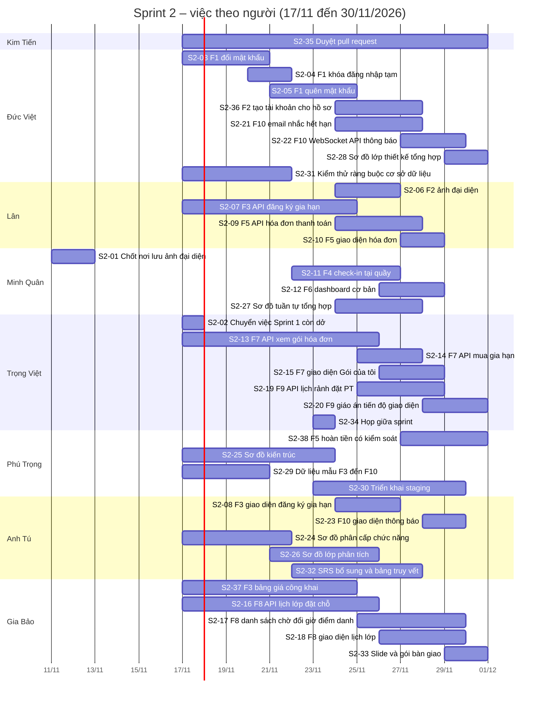

# Kế hoạch Sprint 2 (17/11 – 30/11/2026)

- **Trạng thái:** dự thảo, cập nhật sau khi Sprint 1 dời sang kết thúc ngày 16/11; chốt tại [họp tổng kết Sprint 1](../meetings/2026-11-10-tong-ket-sprint-1.md)
- **Người lập:** Nguyễn Trọng Việt
- **Nguồn:** [bản chốt phạm vi](../requirements/ban-chot-pham-vi.md), [tiến độ Sprint 1](sprint-1-tien-do.md), [ADR 0009](../decisions/0009-bo-so-do-phan-tich-thiet-ke.md), user story F1–F10 và milestone Sprint 2 trên GitHub

**Về ngày:** milestone Sprint 1 trên GitHub kết thúc 16/11, nên Sprint 2 bắt đầu 17/11 và giữ độ dài 14 ngày (17/11 – 30/11). Phương án giữ kết thúc 23/11 chỉ còn một tuần cho cả phần còn lại của v1 và F7–F10; xem mục 5 và 6.

Cột "Người" là **đề xuất** theo nguyên tắc của Sprint 1: ai viết đặc tả và migration của chức năng nào thì làm API và giao diện chức năng đó; ai vẽ wireframe màn hình nào thì làm giao diện màn hình đó. Đổi người hoặc hạn ở cuộc họp thì sửa trong bảng này.

## 1. Phạm vi

- **Phần còn lại của v1:** F1 (đổi mật khẩu, quên và đặt lại mật khẩu, khóa đăng nhập tạm), F2 (tạo tài khoản cho hồ sơ có sẵn, ảnh đại diện), F3 (đăng ký và gia hạn gói, xem bảng giá công khai), F4 (check-in tại quầy), F5 (thanh toán tại quầy, hoàn tiền có kiểm soát), F6 (dashboard cơ bản).
- **v2:** F7 (cổng hội viên), F8 (lớp học nhóm), F9 (huấn luyện viên), F10 (thông báo).
- **Chuyển từ Sprint 1:** việc nào chưa xong khi Sprint 1 đóng ngày 16/11 được chuyển thành issue Sprint 2 ở việc S2-02, giữ người phụ trách cũ.
- **Ngoài phạm vi Sprint 2:** v3 trở đi (F11–F20).

## 2. Việc cần làm

### 2.1 Chốt và chuẩn bị

| Mã | Việc | Người | Bắt đầu | Hạn | Phụ thuộc, ghi chú | Issue |
| --- | --- | --- | --- | --- | --- | --- |
| S2-01 | Chốt nơi lưu ảnh đại diện và ghi ADR | Hoàng Kim Tiến chốt, Lê Phước Minh Quân ghi ADR | 11/11 | 12/11 | F4 cần ảnh để lễ tân đối chiếu; F2 cần để làm ảnh đại diện | — |
| S2-02 | Chuyển việc Sprint 1 còn dở thành issue Sprint 2 | Nguyễn Trọng Việt | 17/11 | 17/11 | Làm ngay khi Sprint 1 đóng ngày 16/11 | — |

### 2.2 Phần còn lại của v1

| Mã | Việc | Người | Bắt đầu | Hạn | Phụ thuộc, ghi chú | Issue |
| --- | --- | --- | --- | --- | --- | --- |
| S2-03 | F1: đổi mật khẩu | Bùi Trần Đức Việt | 17/11 | 20/11 | F1 đăng nhập đã xong | US-F1.4 (#49) |
| S2-04 | F1: khóa đăng nhập tạm sau 5 lần sai (S4) | Bùi Trần Đức Việt | 20/11 | 21/11 | Cột `failed_login_count`, `locked_until` đã có | US-F1.6 (#51) |
| S2-05 | F1: quên và đặt lại mật khẩu, gửi email | Bùi Trần Đức Việt | 21/11 | 24/11 | Cấu hình SMTP dùng chung với F10 | US-F1.5 (#50) |
| S2-36 | F2: tạo tài khoản cho hồ sơ có sẵn (lễ tân tạo, gửi email đặt mật khẩu), API và giao diện | Bùi Trần Đức Việt (API), Nguyễn Anh Tú (giao diện) | 24/11 | 27/11 | S2-05 (email đặt mật khẩu), `MemberService` của Lân | US-F2.2 (#53) |
| S2-06 | F2: ảnh đại diện, API và giao diện | Thái Hùng Lân (API), Nguyễn Anh Tú (giao diện) | 24/11 | 26/11 | S2-01 | — |
| S2-07 | F3: API đăng ký và gia hạn gói, tác vụ nền chuyển EXPIRED và kích hoạt UPCOMING | Thái Hùng Lân | 17/11 | 24/11 | Quy tắc gói trong bản chốt, `uq_one_active_per_type` | — |
| S2-08 | F3: giao diện đăng ký và gia hạn gói | Nguyễn Anh Tú | 24/11 | 26/11 | S2-07, wireframe bán và gia hạn gói | — |
| S2-37 | F3: xem bảng giá công khai cho khách, API và giao diện | Thái Hùng Lân (API), Phạm Gia Bảo (giao diện) | 17/11 | 24/11 | API danh mục gói đã có; wireframe trang khách của Gia Bảo | US-F3.3 (#57) |
| S2-09 | F5: API hóa đơn, ghi nhận thanh toán tại quầy, VietQR, hóa đơn PDF; xử lý hóa đơn chờ do hội viên gửi | Thái Hùng Lân | 24/11 | 27/11 | S2-07; khóa `BANK_*` trong `system_configs` | — |
| S2-10 | F5: giao diện hóa đơn và thanh toán | Thái Hùng Lân | 27/11 | 28/11 | Wireframe check-in, hóa đơn | — |
| S2-38 | F5: hoàn tiền có kiểm soát (chỉ quản lý chi nhánh, ghi nhật ký hoạt động) | Nguyễn Phú Trọng | 27/11 | 30/11 | S2-09; Lân hướng dẫn quy tắc; nếu trễ thì chuyển Sprint 3 | US-F5.2 (#60) |
| S2-11 | F4: API và giao diện check-in tại quầy (tìm theo mã hoặc số điện thoại, kiểm tra gói, trừ buổi gói SESSION) | Lê Phước Minh Quân | 22/11 | 26/11 | S2-07, S2-01 | — |
| S2-12 | F6: API và giao diện dashboard cơ bản | Lê Phước Minh Quân | 26/11 | 28/11 | S2-11, S2-09 | — |

### 2.3 v2: F7 đến F10

| Mã | Việc | Người | Bắt đầu | Hạn | Phụ thuộc, ghi chú | Issue |
| --- | --- | --- | --- | --- | --- | --- |
| S2-13 | F7: API xem gói, lịch sử check-in, hóa đơn của hội viên | Nguyễn Trọng Việt | 17/11 | 25/11 | Đọc các bảng `memberships`, `checkins`, `invoices`; kiểm thử với dữ liệu thật khi S2-07, S2-09, S2-11 xong | US-F7.1 (#62) |
| S2-14 | F7: API gửi yêu cầu mua hoặc gia hạn (hóa đơn chờ, gói PENDING) và tác vụ hủy hóa đơn chờ quá `PENDING_INVOICE_TTL_DAYS` | Nguyễn Trọng Việt | 25/11 | 27/11 | S2-09 xong trước hoặc cùng ngày | US-F7.2 (#63) |
| S2-15 | F7: giao diện "Gói của tôi" theo wireframe cổng hội viên | Nguyễn Trọng Việt | 26/11 | 28/11 | S2-13, S2-14 | US-F7.1, US-F7.2 |
| S2-16 | F8: API lịch lớp lặp, sinh buổi, đặt chỗ, hủy chỗ, quy tắc vi phạm | Phạm Gia Bảo | 17/11 | 25/11 | S2-07 (gói TIME) | US-F8.1–F8.3 (#64–#66) |
| S2-17 | F8: danh sách chờ tự động đưa vào lớp, đổi giờ, đổi phòng, hủy buổi, điểm danh | Phạm Gia Bảo, Nguyễn Phú Trọng hỗ trợ (khóa bản ghi NF6, tác vụ đưa vào lớp) | 25/11 | 29/11 | S2-16; việc khó, xem mục 5 | US-F8.4–F8.6 (#67–#69) |
| S2-18 | F8: giao diện lịch lớp, đặt chỗ, danh sách chờ theo wireframe cổng hội viên | Phạm Gia Bảo | 26/11 | 29/11 | S2-16 | US-F8.2, US-F8.7 (#65, #70) |
| S2-19 | F9: API lịch rảnh, đặt buổi PT, xác nhận buổi | Nguyễn Trọng Việt | 25/11 | 28/11 | S2-07 (gói PT), bảng `staff` | US-F9.1–F9.3 (#71–#73) |
| S2-20 | F9: API giáo án, nhật ký tập, chỉ số cơ thể, tiến độ; giao diện huấn luyện viên | Nguyễn Trọng Việt | 28/11 | 30/11 | S2-19 | US-F9.4 (#74) |
| S2-21 | F10: tác vụ nền gửi email nhắc hết hạn và nhắc lịch lớp | Bùi Trần Đức Việt | 24/11 | 27/11 | S2-05 (SMTP), S2-07 | US-F10.1 (#75) |
| S2-22 | F10: thông báo trong web qua WebSocket, API xem và đánh dấu đã đọc | Bùi Trần Đức Việt | 27/11 | 29/11 | S2-21; thông báo được vào lớp và đổi giờ cần S2-17 | US-F10.2 (#76) |
| S2-23 | F10: giao diện thông báo | Nguyễn Anh Tú | 28/11 | 29/11 | S2-22 | US-F10.1, US-F10.2 |

### 2.4 Sơ đồ còn lại (theo ADR 0009)

| Mã | Việc | Người | Bắt đầu | Hạn | Phụ thuộc, ghi chú | Issue |
| --- | --- | --- | --- | --- | --- | --- |
| S2-24 | Sơ đồ phân cấp chức năng | Nguyễn Anh Tú | 17/11 | 21/11 | — | — |
| S2-25 | Sơ đồ kiến trúc | Nguyễn Phú Trọng | 17/11 | 23/11 | — | — |
| S2-26 | Sơ đồ lớp phân tích | Nguyễn Anh Tú | 21/11 | 25/11 | — | — |
| S2-27 | Sơ đồ tuần tự: mỗi người vẽ một luồng của chức năng mình làm (đăng nhập, gia hạn gói, check-in, đặt buổi PT, đặt lớp và danh sách chờ); Minh Quân tổng hợp | Từng người, Lê Phước Minh Quân tổng hợp | 24/11 | 27/11 | Sau khi các luồng có mã chạy được | — |
| S2-28 | Sơ đồ lớp thiết kế: mỗi người vẽ phần chức năng của mình, Đức Việt tổng hợp | Từng người, Bùi Trần Đức Việt tổng hợp | 29/11 | 30/11 | — | — |

### 2.5 Hạ tầng, kiểm thử, tài liệu, quản lý

| Mã | Việc | Người | Bắt đầu | Hạn | Phụ thuộc, ghi chú | Issue |
| --- | --- | --- | --- | --- | --- | --- |
| S2-29 | Dữ liệu mẫu cho F3–F10 (`db/seed`) | Nguyễn Phú Trọng | 17/11 | 20/11 | — | — |
| S2-30 | Triển khai staging sau mỗi đợt gộp, chạy lại Postman | Nguyễn Phú Trọng | 23/11 | 23/11 và 29/11 | — | — |
| S2-31 | Kiểm thử ràng buộc cơ sở dữ liệu (nếu chưa xong ở Sprint 1) | Bùi Trần Đức Việt | 17/11 | 21/11 | — | — |
| S2-32 | SRS bổ sung F3–F10 và bảng truy vết | Nguyễn Anh Tú | 22/11 | 27/11 | — | — |
| S2-33 | Slide và gói bàn giao Sprint 2 | Phạm Gia Bảo | 29/11 | 30/11 | — | — |
| S2-34 | Họp giữa sprint: rà tiến độ, gỡ vướng | Nguyễn Trọng Việt | 23/11 | 23/11 | — | — |
| S2-35 | Duyệt pull request theo cặp, gộp lên `main` | Hoàng Kim Tiến | 17/11 | 30/11 | — | — |

Cột Issue ghi user story liên quan (milestone Sprint 2 có 27 issue, gần như toàn user story). Dấu "—" là việc chưa gắn với user story nào hoặc chưa đối chiếu số issue; khi tạo issue cho từng việc S2-xx (cùng mẫu task như Sprint 1) thì điền số.

**Quy tắc chung cho mọi việc code:** mỗi người tự viết kiểm thử JUnit và request Postman cho chức năng của mình trong cùng pull request (quy tắc mã nguồn số 14); đọc [checklist-review.md](../guides/checklist-review.md) trước khi mở pull request; thay đổi schema thì thêm file migration mới, không sửa file đã gộp vào `main`.

## 3. Lịch theo người

## 4. Mốc

| Ngày | Mốc |
| --- | --- |
| 12/11 | Chốt nơi lưu ảnh đại diện (S2-01) |
| 16/11 | Sprint 1 kết thúc (milestone GitHub) |
| 17/11 | Bắt đầu Sprint 2; chuyển việc Sprint 1 còn dở (S2-02) |
| 23/11 | Họp giữa sprint (S2-34); staging có F1, F3 (S2-30) |
| 27/11 | API v1 hoàn tất; F7, F8 có API cơ bản trên staging |
| 29/11 | F9, F10 có API; chạy Postman toàn bộ trên staging |
| 30/11 | Kết thúc Sprint 2; sơ đồ và slide nộp |
| 01/12 | Bàn giao và demo Sprint 2 (dự kiến, theo cách Sprint 1 làm; trưởng nhóm xác nhận ở mục 6) |

## 5. Cặp duyệt pull request và rủi ro

Cặp duyệt giữ như Sprint 1: Đức Việt và Lân duyệt lẫn nhau; Anh Tú và Gia Bảo duyệt lẫn nhau; Minh Quân và Trọng Việt duyệt lẫn nhau; Phú Trọng do Hoàng Kim Tiến duyệt. Người duyệt bấm Approve hoặc Request changes, không chỉ để Comment.

- **Thời gian rất sát.** Phần còn lại của v1 (F1, F3, F4, F5, F6) và cả v2 (F7–F10) cùng nằm trong 14 ngày. Nếu chọn kết thúc 23/11 như bản cũ thì chỉ còn một tuần: khi đó nên chuyển F9 và F10 (phụ thuộc F3, F8) sang Sprint 3.
- **Sprint 3 và 4 co lại.** Bản chốt phạm vi kết thúc ngày 21/12; Sprint 2 kéo đến 30/11 thì Sprint 3 và 4 chỉ còn 01/12 – 21/12. Theo bản chốt, nếu trễ thì cắt v5 trước, rồi v4.
- **F8 và F9 khó và phụ thuộc F3.** F8 cần gói TIME còn hiệu lực, F9 cần gói PT và bảng `staff`; nếu S2-07 trễ thì cả hai trễ theo. Đề xuất Phú Trọng hỗ trợ Gia Bảo ở S2-17, vì Phú Trọng giữ schema và có ít việc hơn.
- **Tải không đều.** Đức Việt đang có nhiều việc nhất (F1 còn lại, F2.2, F10, kiểm thử ràng buộc); Anh Tú có nhiều giao diện dồn vào 26/11 – 29/11; Trọng Việt giữ F7 và F9. Việc nào trễ thì chuyển ngay cho người rảnh hơn (hiện là Phú Trọng), không chờ đến cuối sprint.
- **F10 cần F8.** Thông báo được đưa vào lớp và đổi giờ chỉ gửi được khi F8 có sự kiện tương ứng (S2-17).
- **Thay đổi schema giữa sprint.** Không sửa migration đã gộp; mỗi thay đổi là một file mới và cần báo cả nhóm.
- **Render bản miễn phí ngủ sau 15 phút.** Mở staging trước giờ demo vài phút.

## 6. Câu hỏi cần trưởng nhóm chốt

1. **Nơi lưu ảnh đại diện (S2-01, hạn 12/11).** Hai phương án: lưu trong PostgreSQL (ảnh nén nhỏ, chịu chung phân quyền và sao lưu, tăng dung lượng cơ sở dữ liệu) hoặc dịch vụ lưu file ngoài có gói miễn phí (không tốn dung lượng cơ sở dữ liệu, nhưng thêm khóa bí mật và phải kiểm soát ai xem được ảnh; cần kiểm tra điều khoản và hạn mức hiện tại). Cả F2 và F4 chờ câu trả lời này.
2. **Ngày Sprint 2:** 17/11 – 30/11 như bản này, hay giữ kết thúc 23/11 và cắt bớt v2.
3. **Ngày demo Sprint 1 và ngày bàn giao Sprint 2.**
4. **Phân công đề xuất mới:** Phú Trọng hỗ trợ F8 (S2-17) và làm hoàn tiền F5.2 (S2-38); Đức Việt làm API F2.2 (S2-36).
